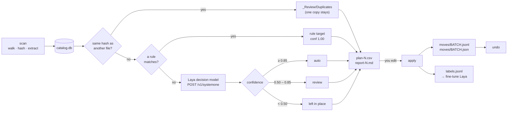

# dewey

Point it at a folder. It catalogs and hashes every file, recommends where each one should
go (exact duplicates first, then your rules, then a small local decision model for the rest),
lets you review the plan, moves the files with a crash-safe journal of what went where and
why, and can undo the whole batch exactly. Everything runs locally; nothing leaves the Mac.



## Quick start (macOS)

```bash
# 1. dewey itself: stdlib-only core, Python 3.11+ (macOS's /usr/bin/python3 is too old)
git clone https://github.com/thatcherstudio/dewey.git
uv venv ~/.venvs/dewey --python 3.12
uv pip install --python ~/.venvs/dewey/bin/python -e './dewey[all]'   # [all] = pypdf, Pillow, pillow-heif, blake3
mkdir -p ~/.local/bin && ln -sf ~/.venvs/dewey/bin/dewey ~/.local/bin/dewey

# 2. the decision model: Laya (421M params, ~800 MB, runs on CPU or MPS)
uv venv ~/.venvs/laya --python 3.11
uv pip install --python ~/.venvs/laya/bin/python 'laya[serve]'
LAYA_HOST=127.0.0.1 LAYA_MODELS=english ~/.venvs/laya/bin/laya-serve
    # own terminal tab; Ctrl-C stops it. Serves POST /v1/systemone on http://127.0.0.1:8000.
    # Settings are env vars only (no flags; `--help` just starts the server). Without LAYA_HOST it
    # listens on your whole network; without LAYA_MODELS it loads all three checkpoints.
curl -s http://127.0.0.1:8000/health  # "status":"ok" once the model has loaded

# 3. use it
dewey init   ~/Downloads              # writes ~/Downloads/.dewey/dewey.toml; edit the folders
dewey doctor ~/Downloads              # extras installed? decider reachable? sample decision + latency
dewey run    ~/Downloads              # scan + plan
open ~/Downloads/.dewey/report-1.md   # read the recommendations
open ~/Downloads/.dewey               # plan-1.csv is here (.dewey is hidden in Finder: ⌘⇧. shows it)
dewey apply  ~/Downloads --dry-run
dewey apply  ~/Downloads              # auto rows only; add --include-review for review rows
dewey undo   ~/Downloads              # reverses the last batch
```

Re-running `dewey scan` only re-hashes files whose size or mtime changed, and files dewey moved
keep their hashes. Re-running `dewey plan` reuses cached decisions for files whose details haven't changed.

## Mac app

Dewey.app does the same steps in windows: add a folder, Scan & Plan with live progress, review the
plan in a table, preview and apply it, undo any batch, and edit the folder's settings. It carries
its own Python 3.12 and dewey (with all the extras), so it doesn't need step 1 of the quick start,
and it never writes dewey's files itself: every change goes through a dewey command. Laya is a
separate download that the app's **Install Laya** button does for you; the app starts and stops
`laya-serve` too. You build it yourself; it isn't signed or notarized.

You need macOS 14 or later, Xcode 16 or later (the Command Line Tools are enough:
`xcode-select --install`), and [uv](https://docs.astral.sh/uv/) (`brew install uv`).

1. Clone it: `git clone https://github.com/thatcherstudio/dewey.git && cd dewey`
2. Build it and open it:

   ```bash
   make run        # builds build/Dewey.app (about 105 MB), then opens it
   ```

   The first build downloads Python and dewey's extras (about a minute); later builds take 3 to
   15 seconds.
3. For the model's decisions, click **Install Laya** on the Setup screen. It downloads Python 3.11,
   Laya, PyTorch and Laya's English model (about 1.7 GB) into
   `~/Library/Application Support/Dewey/Laya`, which takes 5 to 15 minutes, then starts Laya.
   Without Laya, plans use your rules and duplicates only. Already installed Laya with the quick
   start's `uv` lines? Dewey finds it in `~/.venvs/laya` and skips this step.
4. Optional: keep it with your other apps with `ditto build/Dewey.app /Applications/Dewey.app`.

Dewey starts Laya as it opens; the light in the toolbar turns green when the model is ready (click
it to stop or start Laya). Then **Add Folder…** (⌘O) and **Scan & Plan**.

| Tab | What it does | dewey underneath |
|---|---|---|
| Overview | Files, size, duplicates, the last plan and batches; **Scan & Plan** | `status`, `run` |
| Review | The plan as a table: approve, reject, change the folder, Quick Look (Space). **Save** writes `plan-N.csv` | `rows`, `edit` |
| Apply | Every row that will move and every row that won't (with why), then **Move** | `apply --dry-run`, `apply` |
| History | Every batch; **Undo** puts one back | `undo` |
| Settings | Folders for the model, rules, thresholds, folder kinds, the model. **Save** writes `.dewey/dewey.toml` | `config` |

Things worth knowing:

- **Privacy prompts.** macOS asks once per folder before Dewey reads Desktop, Documents, Downloads
  or an external disk. A rebuilt app may ask again, because each build is signed ad hoc on your Mac.
  No Full Disk Access is needed.
- **Settings saves only what differs from dewey's defaults**, so later improvements to the
  defaults still reach you. Saving rewrites `dewey.toml` without your comments; the previous file is
  kept as `dewey.toml.bak`. `dewey config ROOT` prints the same settings in Terminal.
- **The app's dewey is a copy made when you built it.** After `git pull`, run `make app` again. It
  works in Terminal too: `Dewey.app/Contents/Resources/bin/dewey`, which you can link into
  `~/.local/bin` to use as your `dewey`.
- **Dewey > Settings… (⌘,)** holds app preferences: where `dewey` and `laya-serve` are (empty = the
  dewey inside the app, and the `laya-serve` Install Laya set up, else the one in `~/.venvs/laya/bin`,
  `~/.local/bin`, Homebrew, then your shell's `PATH`), the model's URL, and whether Laya starts when
  Dewey opens.
- **Install Laya** uses a copy of uv inside the app, and keeps everything in one folder, which Time
  Machine skips because it downloads again. Cancelled or failed, it keeps what it downloaded, so
  the next try picks up from there. **Remove Laya…** on the Setup screen stops Laya and deletes
  that folder (1.7 GB); after an install that didn't finish, **Delete Downloaded Files…** frees
  what it got. In Terminal, run it as
  `~/Library/Application\ Support/Dewey/Laya/bin/laya-serve`.
- **Quitting** stops the `laya-serve` the app started, and an install in progress. A move in
  progress stops after the file in hand, and History can undo what moved.
- **To start over**, `defaults delete io.github.thatcherstudio.dewey` forgets the folder list and
  preferences. Each folder's `.dewey/` stays.

## Choosing a decider

| `--backend` | What | Confidence | Speed (rough) | Notes |
|---|---|---|---|---|
| `systemone` (default) | Laya via `laya-serve`, or any server that speaks `/v1/systemone` | calibrated probability over your folders | vendor figures: ~35 ms/file on GPU, ~0.2–0.5 s on CPU | The answer is always one of your folder keys. 512-token context. |
| `chat` | Any OpenAI-compatible server: `mlx_lm.server`, oMLX, Ollama, LM Studio, vLLM | self-reported, **not** calibrated | ~0.5–2 s per file | Capped below `auto_confidence` unless you set `trust_chat_confidence = true`, so a person reviews every model move. |
| `none` | Rules + duplicates only | n/a | instant | Unmatched files are left in place. |

Chat example with a 4-bit 4B model (~2.5 GB):

```bash
pip install mlx-lm
mlx_lm.server --model mlx-community/Qwen3-4B-Instruct-2507-4bit --port 8080
dewey plan ~/Downloads --backend chat --url http://127.0.0.1:8080 --model mlx-community/Qwen3-4B-Instruct-2507-4bit
```

**About Laya's accuracy.** Its model card describes it as a fast base to specialize, not a zero-shot
decision engine, and the vendor's typed-decision score is in the mid-70s. Treat the confidence
tiers as the safety net, and expect review rows on the first runs. Every row you accept or correct
is saved as a label (see *Fine-tuning* below), so it gets better on your files over time.

## What it writes (all in `ROOT/.dewey/`)

| File | What | Why this format |
|---|---|---|
| `catalog.db` | Every file: path, size, dates, hash, text preview, EXIF, kind | SQLite: queryable, updated in place, no size ceiling. JSON would be rewritten whole on every scan and can't be queried. |
| `plan-N.csv` | One row per proposed move: status, src, dst, category, confidence, who decided, why, runner-up | Opens in Numbers, sorts and filters; the editable part of the workflow. |
| `report-N.md` | Summary, destination tree, pie chart, duplicate groups, review and unsure lists, things kept whole | Readable in any Markdown viewer (Obsidian/GitHub render the Mermaid chart). |
| `moves/BATCH.jsonl` | Append-only journal; each move is written and fsync'd **before** it happens | Survives a crash or Ctrl-C mid-run; undo checks the disk rather than trusting the log. |
| `moves/BATCH.json` | Pretty summary: every move `from`, `to`, `reason`, `category`, `decided_by`, `confidence`, `hash` | The "where did it go and why" file. |
| `labels.jsonl` | `dewey export-labels`: state + options + your final label + what the model proposed | Training data for fine-tuning. |

Handy queries:

```bash
sqlite3 ~/Downloads/.dewey/catalog.db \
  "select hash, count(*) n, size*(count(*)-1) wasted from files where kind='file' and missing=0
   group by hash having n>1 order by wasted desc limit 20;"
sqlite3 ~/Downloads/.dewey/catalog.db \
  "select ext, count(*), sum(size)/1e9 gb from files where missing=0 group by ext order by gb desc limit 15;"
```

## Editing the plan

`status` is `auto`, `review` or `skip`. `apply` moves `auto` rows (plus `review` rows with `--include-review`).

- **Approve** a review or unsure row: set `status` to `auto`.
- **Reject** a row: set `status` to `skip`, or delete the line. Rejected model rows are logged as negative labels.
- **Correct** a row: change `category` to another folder key from `dewey.toml` (dst is recomputed), or edit `dst` directly.
  `category = other` (any key with `path = ""`) means "leave it here" and is saved as a correction label.
  A misspelled category is refused, so the row doesn't move. A `dst` ending in `/`, or naming a folder
  that exists, means "into that folder": `Data/Exports/` gives `Data/Exports/data.csv`.
  For a whole-folder row (`action` = `folder`), `category` can also be a kind from `[folders]` (`code`, `cad`, …).
- Don't edit `src` or `row`. Rows with an edited `src` are refused.

The CSV is saved as UTF-8 with a BOM, so Excel and Numbers open accented filenames correctly. When you
save from Excel, choose "CSV UTF-8": plain "CSV" can mangle accented names, and those rows are then
refused (never mis-moved).

## Safety

- **Nothing is deleted.** Duplicates, empties and junk go to `_Review/` for you to empty yourself.
  The only exception is `--prune-empty`, which removes folders the move left empty (a lone
  `.DS_Store` counts as empty).
- **No overwrites.** Moves use hard-link + unlink (atomic, fails if the name is taken). Where a filesystem
  has no hard links, dewey checks first and then renames. Name clashes become `name (2).ext`, compared
  case- and Unicode-insensitively like APFS.
- **Changed since the scan?** If size or mtime differ from the catalog, dewey re-hashes the file and
  skips it on a mismatch.
- **Across volumes** (`--dest /Volumes/…`): copy, verify the hash, flush the copy to the disk, and
  only then remove the source. Finder tags, "where from" and the creation date go with the file
  (and come back with undo).
- **Folders stay whole by default.** Only loose files in the top folder are planned
  (`max_depth = 0`); nothing is pulled out of a subfolder, not even a duplicate (when a loose file
  duplicates one inside a folder, the loose copy goes to review). `max_depth = -1` files everything
  individually and splits folders.
- **Whole-folder moves.** The report labels each of those folders (code project, 3D-print / CAD
  project, design files, image set, photos, documents, …) and says why ("9 .stl, 1 .scad, README").
  A folder whose kind has a home in `[folders]` gets ONE `review` row that renames the whole folder
  into place (`birdhouse-v2/` → `3D & CAD/birdhouse-v2/`), contents untouched, same disk only.
  Nothing moves until you approve it; undo puts the folder back as one piece.
- **Kept whole:** `.app`, `.photoslibrary`, `.fcpbundle`, `.pages`/`.numbers`/`.key`, VM packages
  (`.utm`, `.pvm`, `.vmwarevm`) and other bundles (plus any folder with `Contents/Info.plist`), and any
  project folder (one containing `.git`, `package.json`, `pyproject.toml`, `Makefile`, …: see
  `project_markers`) are cataloged as one unit and never opened or split.
- **Interrupted?** Each move is committed as it happens, and a batch stopped by a crash, Ctrl-C or a
  closed terminal still shows up for a plain `dewey undo ROOT`.
- **Never touched:** symlinks (recorded, not followed: no cycles, nothing outside the root),
  iCloud "Optimize Storage" placeholders (cataloged but not read, so a scan doesn't download your
  iCloud Drive), and `.DS_Store`.
- **Hidden files are left alone.** Anything whose name starts with a dot, or that Finder hides, is
  settings or app data: it is never cataloged, planned or moved, and neither is anything inside a
  hidden folder. A hidden file inside a folder that moves whole travels with it.
  `include_hidden = true` under `[scan]` treats them like any other file. Another folder's `.dewey`
  is skipped either way.
- **Not every folder.** dewey refuses the whole disk, a folder that holds your home folder, your
  Library (except the iCloud Drive and cloud-storage folders in it) and the system's folders. The
  app asks before it adds your whole home folder.
- **The folder can move.** Plans and journals keep paths relative to the folder, so after you rename
  it, copy it, or plug its drive in under another name, `apply` and `undo` work inside the folder
  you name. Only a `dest` outside the folder stays where it was.
- **Undo** restores files to their exact original paths, skips any file that was modified after the
  move, and removes the folders the batch created (a lone `.DS_Store` from Finder counts as empty).

## Tuning

- **Point it at messy folders** (Downloads, Desktop, an old drive dump), not an already-organized tree.
  The default `max_depth = 0` leaves every subfolder as it is; raise it only for a dump of loose
  folders you want taken apart.
- **Rules first.** Anything you can say with an extension, a name regex or a path regex belongs in
  `[[rules]]`: it's instant, explainable and right every time. The model only sees what's left.
- **Folders (`[categories]`)** are what the model chooses between. 10–25 short, concrete descriptions
  work best. Laya's 512-token context holds the descriptions *and* the file summary, which is why
  `snippet_chars` defaults to 400.
- **Thresholds:** `auto_confidence` (0.85) and `review_confidence` (0.50) are starting points.
  After a few batches, compare `accepted` vs `corrected` labels by confidence and move them.

## Fine-tuning on your own decisions

```bash
dewey export-labels ~/Downloads            # accepted + corrected
dewey export-labels ~/Downloads --include-rejected -o all.jsonl
```

Each line has `state` (exactly what the model saw), `options`, `label` (your final answer),
`proposed` and `source`. This is a neutral format. Map it to whatever Laya's trainer expects;
I haven't verified that format.

## Development

```bash
python -m unittest discover -s tests -v     # fake Laya + fake chat servers; full scan→plan→apply→undo
make test                                   # the same, then the Mac app's Swift tests
make test-app                               # both again, against the Python and dewey inside the app
```

The Mac app is a SwiftPM package in `mac/`: `DeweyCore` (running dewey, decoding its events, the
models behind each tab; all tested) and `Dewey` (SwiftUI). It drives dewey through `--json`: one JSON
event per line on stdout, ending in exactly one `result`, `error` (with a `code`) or `interrupted`
event; Cancel is SIGINT. `make app` runs `scripts/build-app.sh`, which puts uv's standalone CPython
(trimmed, with dewey and its extras installed) in `Contents/Resources/python` and a `bin/dewey`
launcher beside it that runs it isolated (`-I`) and writes no `.pyc` files into the signed app.
`build/python` keeps that Python between builds. `swift scripts/make-icon.swift` redraws the icon.

Design notes: skip-dirs match directories only and are configurable; symlinks are never followed
(no cycles, no paths escaping the root); files that disappear are marked `missing` in this root's
own catalog, never deleted.
